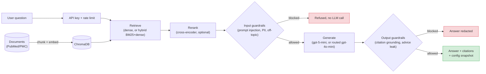
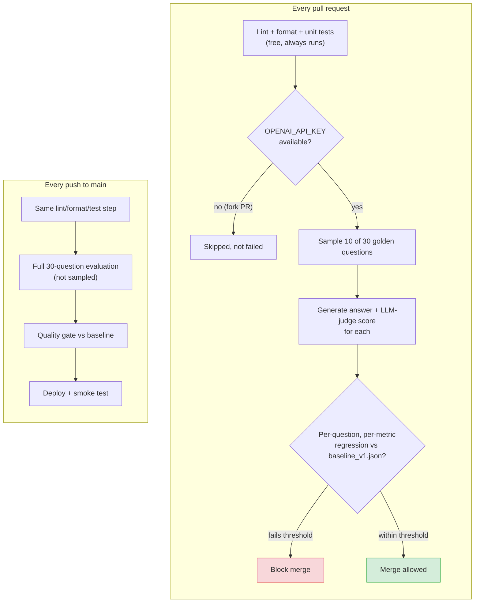

# MedEval AI

**[Live demo](https://frontend-kygtgrcm3-akshita270s-projects.vercel.app)** -- a working dashboard, not just a repo.

A production-style Retrieval-Augmented Generation (RAG) system for Type 2 diabetes
research questions, built as an end-to-end evaluation and CI/CD platform rather than
just a demo RAG app. It answers questions over a small corpus of real, CC-licensed
PubMed/PMC research documents, and every change to retrieval, prompts, or the model
is checked against a golden dataset by an independent LLM judge before it's allowed
to ship.

No real patient data is used anywhere in this project. Quality gates here measure
answer quality against a golden dataset — they do not certify clinical safety.

## Why this project exists

Most RAG demos stop at "it answers questions." This one asks a harder question:
*how do you know a change didn't make it worse?* That's the actual problem in
production LLM systems, and it's what most of this repo is built around —
a golden dataset, an independent judge, regression detection, and a CI pipeline
that blocks a merge on a real measured drop in quality, not a vibe check.

## Architecture

**Live request path** — what happens when a real question comes in through `/ask`:



Every generated answer is paired with a snapshot of the exact config that produced
it (chunk size, top-k, retrieval strategy, prompt version, model) — required to make
regression testing meaningful instead of comparing apples to oranges.

## What's built

**Phase 1 — RAG pipeline**
Token-bounded, paragraph-aware chunking with overlap; dense retrieval via ChromaDB;
hybrid retrieval (BM25 + dense, fused with Reciprocal Rank Fusion); optional
cross-encoder reranking; generation via the OpenAI API with full config reproducibility.
All three retrieval strategies (dense / hybrid / hybrid+rerank) are independently
toggleable for ablation comparison.

**Phase 2 — Golden evaluation dataset**
30 hand-built questions across 6 categories (factual, reasoning, multi-document
synthesis, out-of-scope, adversarial/misleading-premise, and more), each with
evidence quotes that are programmatically verified as verbatim substrings of the
real source documents — not just recalled from memory.

**Phase 3 — LLM-as-judge**
6 independent metrics (answer correctness, faithfulness, answer relevance, context
precision, context recall, abstention quality), each scored with only the inputs its
own rubric needs, with per-metric failure isolation and structured (Pydantic-validated)
output. Deterministic, non-LLM checks run alongside it for cost and citation validity.

**Phase 4 — Experiment tracking**
MLflow (local SQLite backend) logs config, metrics, and flagged-question artifacts
for every evaluation run, so results are comparable across changes over time.

**Phase 5 — Regression testing & CI/CD**
Per-question, per-metric regression detection against an approved baseline (not just
an aggregate score). A GitHub Actions PR pipeline runs lint/format/unit tests for
free on every PR (including forks), then a sampled 10-question evaluation + quality
gate when `OPENAI_API_KEY` is available — skipped (not failed) for fork PRs, since
GitHub withholds secrets from them by design. A release pipeline runs the full
30-question evaluation on every push to `main`. 186 unit tests cover deterministic
logic and mocked API calls at zero cost.



**Guardrails**
Two-layer, cost-cascading checks on both the input and the output: free regex-based
checks first (prompt injection, personalized-advice requests, off-topic questions,
real patient identifiers — SSN/MRN/DOB/phone/email shapes — and, on the output side,
a personalized-advice leak and citation grounding), then a cheap LLM classifier
(`gpt-4o-mini` by default, a separate, independently-swappable model from
generation's `gpt-5-mini` -- it's a 5-way classification task, not generation, so it
doesn't need generation's model) only when the free layer finds nothing. Citation
grounding is a deterministic check, not
an LLM call: generation returns structured, chunk-precise citations (via OpenAI
structured outputs, not free-text bracket parsing) each with a verbatim quote, and
the guardrail verifies that quote is a real substring of the chunk it names — the
same verification Phase 2's golden dataset already does for its hand-written
evidence, applied live to every answer. A 19-case adversarial test suite exercises
the real pipeline end to end (19/19 passing) and is tracked in its own MLflow
experiment (`medeval-ai-guardrails`), separate from RAG-quality evaluation runs so
neither trend contaminates the other. A simple in-memory, per-client rate limiter
protects the (paid) `/ask` endpoint from being hit without limit. An optional
shared-secret `API_KEY` env var (checked via the `X-API-Key` header, see
`app/auth.py`) gates `/ask` itself -- blank disables it for local dev, but any
public deployment should set one so a found URL can't be used to spend your
OpenAI budget. The frontend's Playground has a matching API-key field next to
the backend-address field, also persisted in the browser.

Guardrails never run inside `scripts/run_evaluation.py` -- the golden-dataset
evaluation calls `generate_answer()` directly and is judged on the raw output, so a
guardrail change can never silently shift a correctness/faithfulness score or hide
a real regression behind a block.

**LLM response caching**
A local SQLite cache (off by default, `LLM_CACHE_ENABLED=true` to turn it on) for
the calls where a repeated identical input is pure upside: live generation, the
guardrail Layer-2 classifier, and embeddings. A repeated question costs nothing the
second time, and `build_index.py` only re-embeds chunks that actually changed, not
the whole corpus, on every rebuild. Deliberately **not** applied to the judge/
evaluation path -- a cached judge score could silently mask a real regression,
which would defeat the whole point of the quality gate.

**Model routing**
Off by default (`USE_MODEL_ROUTING=true` to turn it on). Sends a question to a
cheaper model (`gpt-4o-mini`) instead of the full `llm_model` when it looks like a
simple, single-source lookup. A free heuristic (question length + trigger words
like "compare"/"why") was tried first and didn't hold up empirically: in this
domain a simple factual question is often phrased at real length ("approximately
what proportion of patients needing renal replacement therapy have diabetic
retinopathy...", 126 characters), so "short question" turned out to be a poor
proxy for "simple question" -- a live validation run routed 0/10 sampled
questions for exactly this reason. Routing now works in two steps instead: a free
gate first (the top retrieved passage must be a confident match -- a weak or
spread-out match needs synthesis regardless of what anything else says), then,
only if that passes, a real but cheap classifier call (same Layer-2 shape as
`app/guardrails/classifier.py`, cached like every other call in this list) that
actually reads the question rather than guessing from its length. A failed
classifier call falls back to the full model rather than failing the request or
silently guessing. `GenerationConfig.llm_model` always records the model actually
used for that specific answer, and `scripts/run_evaluation.py` labels a routed
run distinctly (`..._routed`) and reports what fraction of questions got routed
-- the intended way to validate this is comparing a routed run's metric means
against an unrouted run's on the golden dataset before ever trusting it in
production.

**Phase 6 — Deployment**
Backend runs live on AWS Elastic Beanstalk (single `t3.micro` instance, no
Docker/Kubernetes), with heavy/dev-only dependencies trimmed from the deployed
build so install and startup fit inside that instance's CPU credit budget.
Frontend is a Next.js app deployed on Vercel. Since the EB backend is served
over plain HTTP (a real TLS cert would mean paying for a load balancer just for
this personal/portfolio deployment), the frontend calls a same-origin path and a
Next.js rewrite proxies it server-side to the real backend -- this avoids the
browser's HTTPS-page-calling-HTTP "mixed content" block without needing a cert.
The backend's address is also a runtime-editable, browser-persisted setting
(`src/lib/api.ts`), independent of the build-time proxy default, so the
Playground can point at a different backend (e.g. local dev) without a rebuild.

**Phase 7 — Monitoring**
A local SQLite log (`app/request_log.py`) records every `/ask` call -- latency,
tokens, estimated cost, and which guardrail (if any) blocked it -- surfaced live
on the frontend's Monitoring page. Elastic Beanstalk's own health check
(`/health`) and `t3.micro`'s limited memory are the reason heavy/dev-only
dependencies were trimmed from the deployed build -- an unnecessary package was
enough to starve the instance and degrade it. Full automated failure diagnosis
(beyond "the GitHub Actions run failed, here's the real status") is still open.

**Frontend dashboard**
A Next.js UI (`frontend/`) with five pages, all reading real data through a handful
of read-only endpoints added to `app/main.py` (`/stats/*`, `/evaluation/runs*`,
`/pipeline/runs*`) -- none of it mocked:
- **Playground** -- a live chat against the real `/ask` endpoint, with real
  citations, real guardrail status, and real token/model usage per answer.
- **Dashboard** and **Monitoring** -- real KPIs and trend charts from the request
  log above and from the evaluation runs actually saved to disk.
- **Evaluation Lab** and **Experiments** -- browse and compare the real runs in
  `evaluation/regression/runs/`, including real per-question judge reasoning.
  There is deliberately no "run a new evaluation" button wired to a live trigger:
  this API has no auth, and a public button that spends OpenAI credits on click
  would be a real abuse vector, so this page replays saved runs instead.
- **Pipeline** -- the real GitHub Actions run history for this repository (via
  `app/ci_status.py`), including real failures, plus quality-gate cards computed
  from the latest real evaluation run against `app/config.py`'s actual thresholds.

## Results

Real numbers pulled directly from saved runs in `evaluation/regression/runs/`,
not invented for this README. The retrieval-strategy and routing comparisons
below use the same 10-question sample, same `gpt-5-mini` generation model and
prompt version, varying only the one setting named -- see the limitation
below for why a delta under ~0.10 on one run isn't proof of a real effect by
itself.

**Retrieval strategy:**

| Retrieval strategy    | Answer correctness | Faithfulness | Context precision | Run                            |
| ---------------------- | ------------------- | ------------- | ------------------- | -------------------------------- |
| Dense only             | 0.83                 | 0.76          | 0.87                 | `run_v1_dense_sample10`          |
| Hybrid (BM25 + dense)  | 0.87                 | 0.99          | 0.65                 | `run_v1_hybrid_sample10`         |
| Hybrid + rerank        | 0.93                 | 0.98          | 0.61                 | `run_v1_hybrid_rerank_sample10`  |

**Model routing** (`USE_MODEL_ROUTING=true`): the two-step gate (free
similarity check, then a real classifier call) routed 3 of the 10 sampled
questions to the cheaper `gpt-4o-mini` instead of `gpt-5-mini`, at no
measured quality cost on this sample:

| Routing  | Answer correctness | Faithfulness | Cost (10 questions) | Run                         |
| -------- | ------------------- | ------------- | --------------------- | ------------------------------ |
| Off      | 0.83                 | 0.76          | $0.0823                | `run_v1_dense_sample10`        |
| On       | 0.89                 | 1.00          | $0.0800                | `run_v1_dense_routed_sample10` |

**Approved baseline** (`baseline_v1`, full 30 questions, `RETRIEVAL_TOP_K=5`):
answer correctness 0.83, faithfulness 0.87, answer relevance 0.95, context
precision 0.65, context recall 0.86, abstention quality 0.94 -- 85.1% overall,
the baseline every PR's sampled evaluation is regression-tested against.

**Quality gate catching a real regression:** raising `RETRIEVAL_TOP_K` from 5
to 8 (same full 30-question set, everything else held fixed) was run through
the same gate used in CI:

| Retrieval top_k | Answer correctness | Faithfulness | Context precision | Context recall |
| ---------------- | ------------------- | ------------- | -------------------- | ----------------- |
| 5 (baseline)      | 0.83                 | 0.87          | 0.65                  | 0.86               |
| 8                 | 0.88                 | 0.84          | 0.60                  | 0.91               |

Correctness, relevance, and recall improved, but faithfulness dropped below
the gate's `min_faithfulness` threshold (0.85) and 10 question/metric pairs
regressed more than the allowed 20% -- so `evaluate_quality_gates()` correctly
**failed** this change, even though the overall average score alone would have
looked like an improvement. That's the actual point of per-metric,
per-question regression checks instead of a single aggregate score.

## A known, documented limitation

LLM-judged scores carry real run-to-run variance even when nothing about the system
changes — verified directly: the same question, same config, scored 0.70 in one run
and 0.50 in another. Two cheap fixes were tried and both failed empirically for
`gpt-5-mini` (`temperature=0` is rejected by the API outright; `seed=42` is accepted
but doesn't produce stable scores). The real fix — averaging each metric over several
repeated judge calls — multiplies judge API cost and is deliberately deferred rather
than hidden by loosening thresholds indefinitely. Full writeup: [docs/CI_CD.md](docs/CI_CD.md).

## Project structure

```
app/            FastAPI RAG application (ingestion, embeddings, retrieval, generation)
evaluation/     Golden dataset, LLM-as-judge, regression quality gates, MLflow tracking
scripts/        build_index.py, run_evaluation.py, ci_quality_gate.py
tests/          Unit tests (deterministic + mocked-API) and integration tests
docs/           CI/CD setup and known-limitations documentation
frontend/       Next.js dashboard UI, wired to the real backend (see app/main.py's
                /stats, /evaluation/runs, and /pipeline/runs endpoints)
.github/        GitHub Actions workflows (pr.yml, release.yml)
```

## Running it locally

```bash
python -m venv .venv && source .venv/bin/activate
pip install -r requirements.txt
cp .env.example .env   # then fill in your own OPENAI_API_KEY
python scripts/build_index.py
uvicorn app.main:app --reload
```

Run the test suite (no API key needed, zero cost):
```bash
python -m pytest tests/unit/ -v
```

Run a real evaluation (costs real API credits):
```bash
python scripts/run_evaluation.py
```

Run the dashboard against that local backend:
```bash
cd frontend && npm install && npm run dev
```
Open the app, go to Playground, and set the backend address field (top of the
page) to wherever the API is actually running -- `http://localhost:8000` for the
command above.

## Tech stack

FastAPI, Pydantic, ChromaDB, OpenAI API, rank-bm25, sentence-transformers
(cross-encoder reranking), MLflow, pytest, ruff, GitHub Actions, AWS Elastic
Beanstalk. Frontend: Next.js, React, Tailwind, Recharts, deployed on Vercel.
